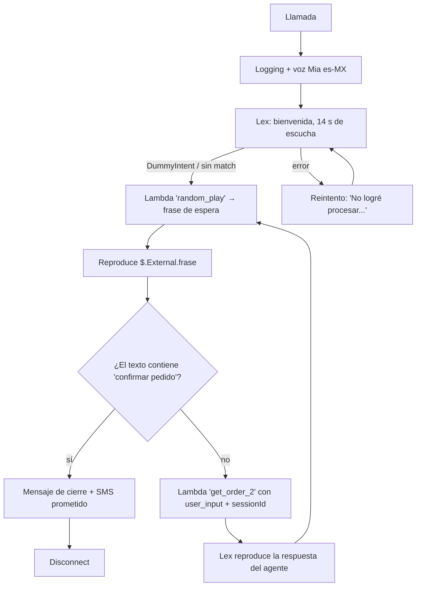

# Paquete prioritario: Grupo Comida → Demo Bancaria Antifraude

Análisis de solo lectura. No modifiqué archivos ni recursos AWS. Para el estado real de la sandbox solo usé comandos `list`/`get` de la AWS CLI.

Leyenda: ✅ confirmado en código o en AWS · 📄 documentado pero no desplegado · ⚠️ inferido, no verificable

---

## 0. Correcciones a la auditoría anterior

| # | Lo que dije antes | Lo que es correcto | Evidencia |
|---|---|---|---|
| 1 | La demo bancaria usa backend remoto S3 + DynamoDB | El bootstrap crea el bucket y la tabla, pero el bloque `backend "s3"` está **comentado**. El estado sigue siendo **local**, igual que en Grupo Comida | `connect-demo-infra/infra/environments/sandbox/versions.tf` (líneas 16-23), `terraform.tfstate` local |
| 2 | El flujo de Grupo Comida quedó listo para usarse | Está publicado en la instancia bancaria, pero **no funciona**: (a) espera `DummyIntent` y `BankingFraudBot` solo tiene `ReportFraud`, `ConfirmYes`, `ConfirmNo` y `FallbackIntent`; (b) lee `$.External.frase` y `$.External.agentInput`, que ninguna Lambda v2 devuelve; (c) el reemplazo de ARNs que hice (`get_order_2`→GestionarCarrito, `store_agent_conv2`→CrearOrden, `random_play`→ConsultarMenu) no es equivalente en funcionalidad | CLI `lexv2-models list-intents` (es_419); `connect_flows/Gen-AI_Amazon_Connect_Flow.json` |
| 3 | Las Lambdas v2 se pueden invocar desde Connect | Las v2 leen los parámetros del primer nivel del evento (`event.get('accion')`). Connect los envía en `Details.Parameters`, así que una invocación desde Connect llega sin parámetros. Están diseñadas como **tools de un agente**, no para invocarse desde un flujo | `lambda_code/v2/*/handler.py` frente a `connect-demo-infra/src/tools/block_card/handler.py` → `get_parameters()` |
| 4 | Existe un AgentCore Gateway en la cuenta | **No hay ningún gateway en la sandbox `063103265536`**. El que aparece en `resource_policy.json` es de otra cuenta, `187740755764` (probablemente la del cliente) | CLI `bedrock-agentcore-control list-gateways` (vacío) |

---

## 1. Árbol de Terraform y recursos AWS

### Grupo Comida — `voice-order-connect/terraform/` (sin módulos)

```
terraform/
├── versions.tf  providers.tf  variables.tf  terraform.tfvars  outputs.tf
├── iam.tf        → 1 rol compartido + 3 políticas (logs, lambda:Invoke, secretsmanager)
├── lambdas.tf    → 7 aws_lambda_function (archive_file por handler.py)
├── connect.tf    → 1 aws_connect_contact_flow + 3 aws_lambda_permission
├── connect_flows/Gen-AI_Amazon_Connect_Flow.json
├── gateway_schemas/*.json   → schemas de tools MCP (no los usa Terraform)
└── lambda_code/{v2, legacy}
```
Estado local en `terraform.tfstate`. No usa CloudFormation.

### Banca — `connect-demo-infra/infra/` (con módulos)

| Módulo | Recursos | Estado |
|---|---|---|
| `bootstrap/` | Bucket S3 y tabla DynamoDB para guardar el estado | Creados, pero el backend no está activado |
| `modules/dynamodb` | Tabla única, PK/SK + GSI1 (`CARD#…`, `CUSTOMER#…`, `TXN#…`) | ✅ |
| `modules/iam` | Rol Lambda (logs, DynamoDB, `bedrock:InvokeModel`), rol para que Connect invoque, rol AgentCore | ✅ |
| `modules/lambda` | 4 tools con `for_each`, log groups con retención y `allow_connect` | ✅ |
| `modules/connect` | Instancia, horario 24x7, 2 colas, routing profile, usuario agente, flujos retail y banking | ✅ |
| `modules/observability` | Tópico SNS para alarmas, alarmas de errores Lambda, dashboard CloudWatch, log groups | ✅ |
| `modules/agentcore` | `aws_bedrockagent_*` | Comentado en el módulo y en `main.tf` |

### Estado real de la instancia `connect-demo-sandbox-banking` (CLI)

| Recurso | Gestionado por |
|---|---|
| `connect-demo-banking-sandbox-retail-flow` | Terraform banca |
| `connect-demo-banking-sandbox-banking-flow` | Terraform banca (solo encola a BankingQueue) |
| `connect-demo-banking-sandbox-banking-flow-v2` | **Creado manualmente, fuera de Terraform.** Es el flujo antifraude que no se debe tocar |
| `Gen-AI Amazon Connect Flow - GrupoComidas` | Terraform Grupo Comida, desplegado en la instancia bancaria |
| Bot Lex `BankingFraudBot` (es_419) | **Manual, fuera de Terraform** |
| Lambdas asociadas a la instancia | Solo las 4 bancarias. Las de Grupo Comida tienen `aws_lambda_permission` pero no `aws_connect_lambda_function_association` |
| Número telefónico | 1 DID de Argentina |
| Connect Cases | Hay dominios (`demo-act`, `alpha-ib-act-demo-hiring`, de los demos Talent), pero **ninguno asociado** a la instancia bancaria |
| Amazon Q in Connect | 2 asistentes de Talent, ninguno bancario |

---

## 2. Inventario de Lambdas

### Grupo Comida v2 (desplegadas en la sandbox)

| Lambda | Qué hace | Llama a | Útil para banca |
|---|---|---|---|
| TokenManager | Autentica contra la API externa y guarda el token en Secrets Manager | Secrets Manager, HTTP | Patrón, si la banca integra una API core real |
| ValidarCliente | Busca al cliente por teléfono y decide `flujo1/2/3` | TokenManager, ConsultarMenu (async) | Patrón para "identificar titular por ANI" |
| ConsultarMenu | Catálogo con caché en memoria y 3 reintentos con backoff | TokenManager | No |
| GestionarCarrito | Estado stateless: el carrito viaja en el payload | ConsultarMenu | Patrón para el estado del caso |
| CrearOrden | POST de la orden (timeout HTTP 120 s, Lambda 30 s) | TokenManager | No |
| ConfirmarPago | Efectivo o tarjeta. Con tarjeta dispara el SMS en async | TokenManager, EnvioSMS | Patrón "acción crítica → notificación" |
| EnvioSMS | `sns.publish` Transactional, normaliza a E.164 (+504) | SNS | **Sí, casi sin cambios** |

Formato de respuesta: `{statusCode, body:{success,...}}` anidado. Incompatible con lo que espera el banco: un mapa plano de strings para Connect, como en `block_card.connect_response()`.

### Grupo Comida legacy (no desplegadas, el código más valioso)

`lambda_code/legacy/capturar_input/` es el orquestador conversacional. Se detalla en la sección 4.

### Banca (desplegadas)

| Lambda | Bedrock | Datos |
|---|---|---|
| `get-transactions` | ✅ `invoke_model` resume movimientos y destaca los sospechosos | DynamoDB |
| `block-card` | ✅ `invoke_model` redacta la confirmación (solo envía los últimos 4 dígitos) | DynamoDB GSI1 |
| `get-order`, `change-delivery-address` | — | DynamoDB (retail) |

---

## 3. Arquitectura de Amazon Connect: comparación

| Aspecto | Grupo Comida (flujo del repo) | Grupo Comida (legacy, por el código) | Banca |
|---|---|---|---|
| Entrada de la llamada | Logging → voz Mia es-MX → bloque Lex | Connect pasa `marca`, `telefono`, `flow_action` como session attributes de Lex ⚠️ (el flujo que lo hace no está en el repo) | DID → `banking-flow-v2` (manual) |
| Quién genera la respuesta | Lambdas externas `get_order_2` y `store_agent_conv2` → `$.External.frase` ⚠️ (su código no está en el repo) | **Code hook de Lex → Lambda → Bedrock** ✅ | Lambda tool → Bedrock ✅ |
| Contexto | `$.Lex.SessionAttributes.sessionId` / `originalValue` | Session attributes de Lex (carrito, stage, contador de errores) | Atributos de contacto |
| Ramificaciones | `Compare` sobre el texto: "confirmar pedido", "confirmado"… | Máquina de estados por `stage_actual` | Intents `ConfirmYes` / `ConfirmNo` |
| Errores | `initial_try_again` → vuelve a Lex | Contador de errores; con 3 o más ofrece pasar con un operador | — |
| Paso a agente | No existe en este flujo | Cierra el intent con `operadora=True` para que Connect transfiera ✅ (`common/operadora.py`) | Transferencia a BankingQueue con contexto |
| Fin | Mensaje de cierre → Disconnect | `resp_close` Fulfilled | — |
| Versionado | JSON en el repo + `aws_connect_contact_flow` | Sin flujo en el repo | `templatefile()` con IDs de cola inyectados ✅ (patrón mejor) |



---

## 4. IA generativa y SMS (foco especial)

### ¿Grupo Comida usa Lambda para hablar con Bedrock durante la llamada?

**Sí, en legacy. ✅** No en v2.

| Patrón | Dónde | Estado |
|---|---|---|
| A. Code hook de Lex → Lambda → Bedrock en cada turno | `legacy/capturar_input/` | ✅ Código completo, no desplegado en la sandbox |
| B. Flujo → InvokeLambda → `$.External.frase` | `connect_flows/…json` | ⚠️ Las Lambdas que generan la frase no están en el repo |
| C. Connect AI Agent + tools MCP vía AgentCore Gateway (el LLM lo orquesta Connect, no Lambda) | `ruta_tecnica_y_documentos/agent_orchestration_v2.md`, `gateway_schemas/` | 📄 Documentado, sin gateway en la sandbox |
| D. Lambda tool → Bedrock para redactar un mensaje (un solo turno) | Banca: `get_transactions`, `block_card` | ✅ Desplegado |

### Patrón A en detalle (el más reutilizable para antifraude)

```mermaid
sequenceDiagram
    participant C as Cliente
    participant AC as Amazon Connect
    participant L as Lex V2
    participant F as Lambda capturar_input
    participant B as Bedrock
    participant S3 as S3 (tracker)
    C->>AC: Habla
    AC->>L: Bloque Lex (session attrs: marca, teléfono, flow_action)
    L->>F: Code hook (inputTranscript + sessionAttributes)
    F->>F: Reglas deterministas primero (operador, input vacío, preorden lista)
    F->>B: invoke_model(system prompt según el stage + menú + sesión, guardrail opcional)
    B-->>F: JSON {para_cliente, siguiente_estado, siguiente_menu, item, guardrail}
    F->>F: Valida el JSON; si falla, contador de errores +1
    F->>S3: Guarda el turno: input, path, modelo, tokens, guardrail, output
    F-->>L: ElicitIntent(para_cliente) o Close(Fulfilled)
    L-->>C: TTS
```

| Pieza | Archivo | Qué aporta a antifraude |
|---|---|---|
| `invocar_bedrock()` | `common/agent.py:81-147` | Claude o Nova según el `model_id`, guardrail por variable de entorno, manejo de `ThrottlingException`, conteo de tokens |
| Prompt por estado + salida JSON obligatoria | `common/contexto.py` → `obtener_system_prompt`, `_generar_formato_json` | El modelo **propone** el siguiente estado y la Lambda **decide**. Así se evitan acciones críticas sin validación (por ejemplo, bloquear solo si `ConfirmYes`) |
| Respuesta del guardrail | `agent.py:352-375` | Si se activa, se pide reformular sin cortar la llamada |
| Escalamiento a humano | `lambda_function.py` (palabras clave + `MAX_INTENT_ERROR=3` + confirmación) y `common/operadora.py` | El mismo flujo para "hablar con un asesor" con contexto |
| Tracker por turno | `common/conversation_tracker.py` → `conversations/{session_id}/turn_NNN.json` | Trazabilidad y auditoría por caso. Nunca rompe el flujo principal |
| Lock idempotente | `uploader.acquire_order_lock()` en `agent.py:175` | Evita un doble bloqueo de tarjeta si Lex reintenta |
| Respuestas Lex | `common/responses.py` | `resp_close` / `resp_elicit_intent`, copiables tal cual |

Variables que usaba en producción (según el comentario de `lambda_function.py`): `BEDROCK_MODEL_ID` (perfil de inferencia Claude 3.7 Sonnet), `BEDROCK_REGION`, `GUARDRAIL_ID`, `GUARDRAIL_VERSION`, `S3_BUCKET_NAME`, `LEX_INTENT_NAME`. No incluyo los valores.

Límites a tener en cuenta: el historial de la conversación no se envía completo al modelo (se usan los session attributes y `ultimo_output`). Los session attributes de Lex solo admiten strings. El tracker cuenta los turnos listando S3, lo que agrega latencia por turno.

### SMS

| Aspecto | Hallazgo |
|---|---|
| Servicio | SNS `publish(PhoneNumber)` directo, Transactional ✅ `v2/envio_sms/handler.py` |
| Cuándo se dispara | Solo en `ConfirmarPago` con tarjeta y si existe link, en async ✅ |
| Plantilla | Hardcodeada: `"tu link de pago para la orden {n}: {link}"` |
| IAM | **Falta `sns:Publish`** en `iam.tf` ✅ |
| Nombre de la función | El default es `…-EnvioSms-Dev` y la real es `…-EnvioSMS-Dev`. `ENVIO_SMS_FN` no se inyecta ✅ |
| **Cuenta sandbox** | **SNS SMS en modo sandbox = True. Solo envía a números verificados.** `MonthlySpendLimit = 1 USD`. No hay números ni sender IDs en End User Messaging ✅ CLI |
| Origen | Sin identidad de origen configurada. Para Argentina/Honduras en producción hace falta registrar una ⚠️ |

Adaptación a banca: invocar EnvioSMS en async al final de `block_card`, después de crear el caso, con `"Tarjeta terminada en {sufijo} bloqueada. Caso {case_id}."`. Nunca incluir el PAN. Antes de la demo, verificar el número destino en el sandbox de SNS y subir el límite de gasto.

---

## 5. IAM, variables y despliegue: riesgos de conflicto en la sandbox

| Riesgo | Impacto | Evidencia |
|---|---|---|
| **El flujo de Grupo Comida vive en la instancia que gestiona el Terraform bancario** | Si el Terraform bancario reemplaza `aws_connect_instance.main`, se pierde el flujo y el estado de Grupo Comida queda roto. El flujo no sirve hoy (sección 0) | `connect.tf` (GC) + `modules/connect/main.tf` (banca) |
| `banking-flow-v2` y `BankingFraudBot` no están en Terraform | Si se cambia el nombre del flujo en Terraform o se edita el bot, no hay forma de reconstruirlos | CLI |
| Ambos estados son locales | Sin lock. Un `apply` desde otra máquina puede divergir | Sección 0 |
| Prefijos distintos (`IVCISA-GrupoComidas-East1-*` frente a `connect-demo-banking-sandbox-*`) | No hay colisión de nombres en IAM ni Lambda ✅ | `iam.tf`, `modules/iam` |
| `statement_id = "AllowConnectInvoke"` en los dos proyectos | Sin conflicto: son funciones distintas ✅ | — |
| `allow_connect` de banca sin `source_arn` | Cualquier instancia Connect de la cuenta puede invocar las tools | `modules/lambda/main.tf` |
| Contraseña del usuario agente en texto plano en Terraform | Queda en el repo y en el estado | `modules/connect/main.tf` (`aws_connect_user.demo_agent`) |
| BUG `telefono = "95171651"` en ValidarCliente v2 | Todas las búsquedas devuelven el mismo cliente | `v2/validar_cliente/handler.py` |
| Credenciales del perfil `sandbox` | En esta sesión imprimí `~/.aws/credentials` en la terminal. **Conviene rotar esa access key** | — |

Recursos previos que necesita Grupo Comida: secretos `grupo-comidas/{ph,kfc,dns,cw}_dev`. Los secretos de token se crean al primer uso **solo si ya existen**, porque el código usa `update_secret` y no `create_secret`. Hay que crearlos antes.

---

## 6. Lo que no pude verificar

- El código de `get_order_2`, `store_agent_conv2` y `amazon_connect_random_play`, que no está en el repo.
- El contenido de `banking-flow-v2` (no lo descargué). Si lo necesitas: `aws connect describe-contact-flow`.
- Si Connect invoca una Lambda con resource policy pero sin `lambda_function_association`.
- El costo real del SMS por país. Depende de la tarifa vigente de SNS o End User Messaging.
