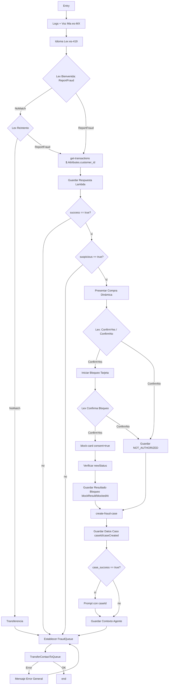

# V3 — Amazon Connect Cases en el flujo antifraude bancario

Plan de cambios para Terraform y para el código del proyecto `connect-demo-infra`, a partir de la propuesta "Demo bancaria antifraude | Mejora V3" (08/10/2026). Prioridad 1: **Amazon Connect Cases**. SMS, dashboard de negocio e IA conversacional ampliada quedan fuera de esta entrega.

Leyenda: ✅ verificado en el repo · ⚠️ por verificar en AWS o en la consola · 🆕 archivo o recurso nuevo · ✔️ ya implementado en Terraform

> Actualizado con los datos reales del export `connect-demo-banking-sandbox-banking-flow-v2.json` (08/10/2026).
> Los cambios de §6 ya están aplicados al código. Lo pendiente es §4 (consola) y §5 (Lambdas).

---

## 1. Contraste entre la propuesta y el repositorio

| Lo que asume la propuesta | Lo que hay en el repo | Estado V3 |
|---|---|---|
| Hay un flujo bancario con Lex, `get-transactions` y `block-card` | `flows/banking.json` (Terraform) **solo encola a BankingQueue**. El flujo real es `connect-demo-banking-sandbox-banking-flow-v2`, creado a mano. El bot `BankingFraudBot` (es_419) tampoco está en Terraform | ✔️ Export guardado en `flows/banking-v2.export.json`. Flujo V3 creado en `flows/banking-v3.json` como recurso Terraform nuevo |
| Se puede declarar Cases en Terraform | Provider `hashicorp/aws 5.100.0` no tiene recursos de Cases ([#33934](https://github.com/hashicorp/terraform-provider-aws/issues/33934)). CloudFormation sí: `AWS::Cases::Domain/Field/Layout/Template` | ⚠️ Fase A desde la consola. IDs recibidos como variables en `terraform.tfvars` |
| Hay un dominio Cases para la instancia | Dominios de demos Talent existentes, **ninguno asociado** a `connect-demo-sandbox-banking` | ⚠️ Pendiente §4.2 |
| `block-card` informa el resultado con consentimiento | Devuelve `success/newStatus`. Sin `blockResult`. Llama a Bedrock en el camino crítico. No recibe `consent` | ⚠️ Pendiente §5.1 |
| `get-transactions` devuelve `customer_id` dinámico | `customer_id` **hardcodeado a `"CUS-2001"`** en el bloque `Get Transactions`. `cardStatus` sale del PROFILE con default `ACTIVE` | ⚠️ Pendiente §5.2. El flujo V3 usa `$.Attributes.customer_id` |
| Prompts dinámicos con monto/comercio/tarjeta | v2 tiene `"850 dólares en Electronics Store"` y `"4455"` **hardcodeados** en los textos | ✔️ V3 usa `$.Attributes.amount`, `$.Attributes.merchant`, `$.Attributes.card_last4` |
| `transactionId` y `operationId` disponibles en el flujo | v2 **no guarda ni pasa** `transactionId` ni `operationId` | ✔️ V3 los guarda en `Guardar Respuesta Lambda` desde `$.External.*` |
| IAM con mínimo privilegio | 4 Lambdas comparten un rol. `allow_connect` sin `source_arn` | ⚠️ Pendiente: crear rol propio `create-fraud-case` en `modules/iam` (§6.3) |
| Logs del flujo de Connect | `aws_connect_instance` sin `contact_flow_logs_enabled` | ✔️ Activado en `modules/connect/main.tf` |
| Cola de fraude | Solo `RetailQueue` y `BankingQueue` | ✔️ `FraudQueue` creada con prioridad 1 en el routing profile |
| `bedrock_model_id` configurable | `sandbox/main.tf` **no pasaba** `bedrock_model_id` al módulo lambda | ✔️ Corregido. `tfvars.example` usa perfil de inferencia `us.*` |
| Bot y alias Lex conocidos | Bot `BankingFraudBot`: `botId=NXHHCKVHHM`, alias `SandboxBanking`: `aliasId=ZSII5DJKMX` | ✔️ ARN precargado en `tfvars.example`. Variable `banking_lex_bot_alias_arn` en Terraform |
| Voz del flujo | v2 usa `Mia` + `es-MX` para TTS y `es-419` para Lex | ✔️ V3 conserva exactamente la misma configuración |
| Timeout de block-card | v2 tiene `InvocationTimeLimitSeconds=3` (muy bajo para Bedrock) | ✔️ V3 sube a `7s`. `get-transactions` conserva `8s` |

---

## 2. Decisiones de diseño

1. **Flujo V3 en paralelo.** Se crea `${prefix}-banking-flow-v3` con Terraform. El número telefónico sigue en v2 hasta que V3 supere las pruebas de §9, y el cambio de número se hace en la consola.
2. **Cases mediante la Lambda `create-fraud-case`**, no con el bloque nativo. La Lambda controla el contrato, la deduplicación y la asociación del contacto como pasos separados.
3. **Deduplicación por incidente.** `operationId = FRAUD-{customerId}-{transactionId}`. Un registro en DynamoDB (`FRAUDOP#`) es la fuente de verdad. El `clientToken` de `CreateCase` sale de un token guardado en ese registro. No se deduplica solo por cliente.
4. **Bedrock no decide.** El consentimiento, el bloqueo y el número de caso se resuelven con lógica determinista. Los textos que oye el cliente sobre el bloqueo y el caso son plantillas fijas.
5. **Ownership.** Customer Profiles, el dominio Cases, la asociación con la instancia, los campos, la plantilla, el bot Lex y el número se gestionan **en la consola** (documentado en §4). Terraform solo recibe sus IDs.
6. **Límite de 8 s de Connect.** El bloque Invoke Lambda corta a los 8 s. Ninguna Lambda del camino crítico debe llamar a Bedrock con respuestas largas.

---

## 3. Fase 0 — Respaldo y línea base

```bash
cd infra/environments/sandbox
git checkout -b feature/v3-cases
cp terraform.tfstate "terraform.tfstate.pre-v3-$(date +%Y%m%d)"

# Línea base ANTES de tocar nada (debe salir limpio o con drift conocido)
terraform init
terraform plan -out=baseline.tfplan
```

**Export del flujo v2 ya realizado** — guardado en:
`infra/modules/connect/flows/banking-v2.export.json`

Datos extraídos del export y registrados:

| Dato | Valor |
|---|---|
| Nombre del flujo | `connect-demo-banking-sandbox-banking-flow-v2` |
| Instance ARN | `arn:aws:connect:us-east-1:063103265536:instance/6198ee3d-76f0-4a24-8171-e50d802cBB71` |
| Bot alias ARN (Lex) | `arn:aws:lex:us-east-1:063103265536:bot-alias/NXHHCKVHHM/ZSII5DJKMX` |
| Bot ID | `NXHHCKVHHM` |
| Alias ID | `ZSII5DJKMX` |
| Alias nombre | `SandboxBanking` |
| Voz TTS | `Mia` / `es-MX` |
| Idioma Lex | `es-419` |
| BankingQueue ARN | `arn:aws:connect:us-east-1:063103265536:instance/.../queue/241a4498-24dc-4bb4-8079-586586a94439` |
| `customer_id` en v2 | **Hardcodeado** a `"CUS-2001"` — corregido en V3 con `$.Attributes.customer_id` |
| Timeout block-card en v2 | `3s` — subido a `7s` en V3 |
| Timeout get-transactions | `8s` — conservado en V3 |

---

## 4. Fase A — Preparar Cases desde la consola

### 4.1 Customer Profiles ⚠️
- En Connect > instancia > **Customer profiles**, verificar si ya está habilitado. Si no, habilitarlo (crea un dominio, por ejemplo `amazon-connect-connect-demo-sandbox-banking`).
- Crear el perfil de prueba de `CUS-2001` con `AccountNumber = CUS-2001`. La Lambda lo buscará por la clave estándar `_account`. Un ID como `CUS-2001` no reemplaza el ARN del perfil.

### 4.2 Dominio Cases y asociación ⚠️
- Revisar la cuota de dominios Cases de la cuenta y la región antes de crear uno.
- Crear el dominio `connect-demo-banking-sandbox-cases` y asociarlo a la instancia desde la consola (equivale a `aws connect create-integration-association --integration-type CASES_DOMAIN --integration-arn <domainArn>`).

### 4.3 Permisos en perfiles de seguridad
- En la consola, al perfil de agente de la demo y al perfil `Admin`: Cases (ver, editar y crear), Audit History (ver), Customer Profiles (ver) y ver colas y usuarios.
- Leer los nombres API reales para llevarlos a Terraform:
  ```bash
  aws connect list-security-profile-permissions --instance-id "$INSTANCE_ID" --security-profile-id <ID>
  ```
- El perfil de agente lo gestiona Terraform: si solo se cambia en la consola, el siguiente `apply` lo revierte. Por eso se copia a `permissions` (§6.4). El perfil `Admin` es nativo y se queda en la consola.

### 4.4 Campos y plantilla "Reporte de fraude bancario"

| Campo | fieldId | Tipo | Valor que envía la Lambda | Requerido en plantilla |
|---|---|---|---|---|
| Título | `title` (sistema) | Text | `Fraude ****4455 - Electronics Store 850.00 USD` | Sí |
| Perfil del cliente | `customer_id` (sistema) | Text (ARN de perfil) | resuelto con `SearchProfiles` | Sí, si se resuelve el perfil ⚠️ |
| Estado | `status` (sistema) | SingleSelect | `open` | — |
| Resumen | `summary` (sistema ⚠️, confirmar con `list-fields`) | Text | resumen factual determinista | No |
| Referencia de cliente | custom | Text | `customerId` | Sí |
| ID de transacción | custom | Text | `transactionId` | Sí |
| Tarjeta (enmascarada) | custom | Text | `****4455` | Sí |
| Resultado del bloqueo | custom | SingleSelect | `BLOCKED`, `ALREADY_BLOCKED`, `FAILED`, `NOT_AUTHORIZED`, `UNKNOWN` | Sí |
| Hora del bloqueo | custom | Text (ISO-8601) | `blockedAt` | No |
| Consentimiento | custom | Boolean | `consent` | Sí |
| Motivo | custom | SingleSelect | `UNRECOGNIZED_TRANSACTION` | No |
| Prioridad | custom | SingleSelect | `HIGH` si `FAILED`/`UNKNOWN`; `MEDIUM` en el resto | No |
| ContactId inicial | custom | Text | `ContactId` | No |
| correlationId | custom | Text | `aws_request_id` | No |
| operationId | custom | Text | `operationId` | Sí |

Después: crear el layout (campos arriba: resultado del bloqueo, tarjeta y prioridad) y la plantilla **Activa**. Obtener los IDs:

```bash
aws connectcases list-fields --domain-id <DOMAIN_ID>
aws connectcases list-templates --domain-id <DOMAIN_ID>
```

### 4.5 Caso manual de prueba
Crear un caso a mano con la plantilla. Verificar que se ve en el espacio de trabajo del agente, que se puede editar y que aparece en el historial de auditoría. **No automatizar hasta que esto funcione.**

### 4.6 Registro de ownership (completar con los IDs de la consola)

| Recurso | Dónde vive | ID / ARN conocido | Quién lo cambia |
|---|---|---|---|
| Bot `BankingFraudBot` + alias `SandboxBanking` | Consola Lex | `NXHHCKVHHM` / `ZSII5DJKMX` — ARN en `tfvars.example` | Manual — no modificar sin exportar la versión |
| Flujo `banking-flow-v2` | Consola Connect | ⚠️ obtener con `list-contact-flows` | Manual (congelado) |
| Flujo `banking-flow-v3` | **Terraform** ✔️ | creado por `aws_connect_contact_flow.banking_v3` | Terraform |
| Dominio Customer Profiles | Consola | ⚠️ `<COMPLETAR>` → copiar a `customer_profiles_domain_name` en `tfvars` | Manual |
| Dominio Cases + asociación CASES_DOMAIN | Consola | ⚠️ `<COMPLETAR>` → copiar a `cases_domain_id` en `tfvars` | Manual (o Fase B CloudFormation) |
| Campos Cases | Consola | ⚠️ `<COMPLETAR>` → copiar a `cases_field_ids` en `tfvars` | Manual |
| Plantilla "Reporte de fraude bancario" | Consola | ⚠️ `<COMPLETAR>` → copiar a `cases_template_id` en `tfvars` | Manual |
| `FraudQueue` | **Terraform** ✔️ | creado por `aws_connect_queue.fraud` | Terraform |
| Número telefónico DID Argentina | Consola | Sin cambios hasta superar §11 | Manual: mover al flujo V3 al final |

---

## 5. Cambios en el código Lambda (`src/tools/`)

### 5.1 `block_card/handler.py` (modificar)

| Cambio | Motivo |
|---|---|
| Nuevo parámetro `consent`: si no es `"true"`, devolver `blockResult="NOT_AUTHORIZED"` **sin tocar DynamoDB** | Defensa en profundidad: `ConfirmNo` nunca bloquea, aunque falle el flujo |
| Nuevo campo `blockResult`: `BLOCKED` · `ALREADY_BLOCKED` · `FAILED` · `NOT_AUTHORIZED` | El expediente distingue los resultados. Hoy "ya bloqueada" y "bloqueada ahora" se ven iguales |
| Nuevo campo `errorCode` (`CARD_NOT_FOUND`, `INVALID_CARD_STATUS`, `CARD_STATUS_CHANGED`, `DATABASE_ERROR`, `CONSENT_REQUIRED`). El texto técnico queda solo en el log | Separar el mensaje público del detalle técnico |
| Nuevo campo `cardReference = "****" + last4` | El flujo y el caso no manejan el `cardId` completo |
| Nueva acción `getCardStatus` (solo lectura) | Contingencia "timeout o respuesta desconocida": consultar el estado real antes de reintentar |
| **Quitar `invoke_bedrock`** y usar un mensaje fijo | Texto controlado sobre el bloqueo y menor latencia frente al límite de 8 s |
| En `update_item`, guardar también `blocked_by_contact` y `operation_id` | Trazabilidad del bloqueo en la tabla |
| Parámetros nuevos opcionales: `operationId`, `contactId` (o tomar `Details.ContactData.ContactId`) | Correlación |

Respuesta (todos los valores son strings):

```json
{
  "success": "true",
  "blockResult": "BLOCKED",
  "cardReference": "****4455",
  "previousStatus": "ACTIVE",
  "newStatus": "BLOCKED",
  "blockedAt": "2026-10-08T15:04:05Z",
  "errorCode": "",
  "message": "La tarjeta terminada en 4455 fue bloqueada."
}
```

### 5.2 `get_transactions/handler.py` (modificar)

| Cambio | Motivo |
|---|---|
| Leer el estado de la tarjeta del ítem `CUSTOMER#id / CARD#cardId`, no del PROFILE con default `ACTIVE` | Hoy informa `ACTIVE` aunque la tarjeta esté bloqueada |
| No registrar `event` completo; registrar solo `ContactId`, `customer_id` y el resultado | Evitar PII (ANI y atributos) en CloudWatch |
| Cambiar `"error": f"...{exc}"` por `errorCode="DATABASE_ERROR"` | No exponer detalles internos |
| Devolver `operationId = FRAUD-{customerId}-{transactionId}`, `cardReference` y `factualSummary` (texto armado sin LLM: comercio, monto, fecha) | Insumos deterministas para `block-card` y `create-fraud-case` |
| Bedrock: bajar `max_tokens` (~200) y limitar `bedrockResponse` a unos 500 caracteres. Opcional: desactivarlo con la variable `ENABLE_BEDROCK_SUMMARY` | Límite de 8 s y tamaño de los atributos de contacto |
| Si `success="false"`, el flujo no reproduce `bedrockResponse` | "No presentar un análisis inventado" |

### 5.3 🆕 `create_fraud_case/handler.py`

**Entrada** (`Details.Parameters`): `customerId`, `customerProfileArn` (opcional), `transactionId`, `cardReference`, `blockResult`, `consent`, `blockedAt`, `summary`, `operationId`.
`ContactId` e `InstanceARN` se toman de `Details.ContactData`. `contactArn = f"{InstanceARN}/contact/{ContactId}"`. No se recibe el PAN ni secretos.

**Respuesta STRING_MAP:** `success`, `caseId`, `caseArn`, `caseCreated`, `contactLinked`, `errorCode`. Plana y sin `statusCode/body`.

**Algoritmo:**

```text
1. Validar entrada (operationId, customerId, transactionId, blockResult ∈ enum). Si falla → errorCode=INVALID_INPUT.
2. Ledger: PutItem PK=CUSTOMER#{customerId}, SK=FRAUDOP#{operationId}
     status=PENDING_CASE, blockResult, consent, attemptToken=uuid4(), createdAt
     ConditionExpression attribute_not_exists(SK)
   - Si ya existe → leerlo:
       · status=CASE_CREATED → caseCreated="false", reutilizar caseId (sin CreateCase).
       · status=PENDING_CASE → reintentar CreateCase con el MISMO attemptToken.
3. Resolver el perfil: si falta customerProfileArn → profile:SearchProfiles(KeyName="_account", Values=[customerId]).
   Si no se encuentra y la plantilla exige customer_id → errorCode=PROFILE_NOT_FOUND (el ledger queda PENDING_CASE).
4. CreateCase(domainId, templateId, clientToken=attemptToken, fields=[...FIELD_IDS...]).
   - Correcto → UpdateItem status=CASE_CREATED, caseId, caseArn.
   - Error → errorCode=CASE_CREATE_FAILED; ledger PENDING_CASE (operación pendiente de registro). NUNCA se vuelve a bloquear.
5. Asociar el contacto (independiente de la creación):
   - Si contactArn ya está en ledger.linkedContacts → contactLinked="true".
   - Si no → CreateRelatedItem(type=Contact, content.contact.contactArn); 1 reintento corto.
     Correcto → ADD linkedContacts. Error → contactLinked="false", errorCode=CONTACT_LINK_FAILED (success sigue en "true" si hay caseId).
6. Log JSON estructurado: event ∈ {case_created, case_reused, case_create_failed, contact_linked, contact_link_failed}.
```

**Variables de entorno:** `CASES_DOMAIN_ID`, `CASES_TEMPLATE_ID`, `CASES_FIELD_IDS` (JSON `{"transactionId":"<uuid>",...}`), `CUSTOMER_PROFILES_DOMAIN`, `DYNAMODB_TABLE_NAME`, `LOG_LEVEL`. Nada de IDs de cuenta escritos en el código.

Reintento de la misma operación (segunda llamada sobre `TXN-9002`): `block-card` devuelve `ALREADY_BLOCKED` y `create-fraud-case` encuentra el ledger con `CASE_CREATED`. Devuelve el mismo `caseId` con `caseCreated="false"` y asocia el contacto nuevo al caso existente.

---

## 6. Cambios en Terraform — ✔️ YA IMPLEMENTADOS

Todos los cambios de esta sección están aplicados al código. Se documenta qué se hizo y qué falta.

### 6.1 Archivos nuevos ✔️

| Archivo | Propósito |
|---|---|
| `infra/modules/connect/flows/banking-v2.export.json` | Export de solo lectura del flujo v2 real. Referencia para auditoría y rollback |
| `infra/modules/connect/flows/banking-v3.json` | Flujo V3 parametrizado con `templatefile()` — 5 variables: `lex_bot_alias_arn`, `get_transactions_lambda_arn`, `block_card_lambda_arn`, `create_fraud_case_lambda_arn`, `fraud_queue_id` |

### 6.2 `infra/environments/sandbox/` ✔️

- `variables.tf`: añadidas `fraud_queue_name`, `enable_banking_v3_flow`, `banking_lex_bot_alias_arn`, `cases_domain_id`, `cases_template_id`, `cases_field_ids` (map), `customer_profiles_domain_name`
- `terraform.tfvars.example`: alias ARN del bot precargado, `bedrock_model_id` corregido a perfil `us.*`, placeholders con comandos CLI para cada ID de Cases
- `main.tf`: módulo `connect` recibe 4 variables V3; módulo `lambda` recibe `bedrock_model_id` (fix) + 5 variables V3; módulo `iam` recibe `cases_domain_id` + `customer_profiles_domain_name`
- `outputs.tf`: añadidos `banking_v3_contact_flow_id`, `fraud_queue_id`

### 6.3 `infra/modules/connect/` ✔️

- `main.tf`:
  - `contact_flow_logs_enabled = true` en `aws_connect_instance`
  - 🆕 `aws_connect_lambda_function_association.create_fraud_case`
  - 🆕 `aws_connect_queue.fraud` con tag `UseCase = FRAUD_V3`
  - Routing profile: prioridad 1 = Fraud, 2 = Banking, 3 = Retail
  - 🆕 `aws_connect_contact_flow.banking_v3` con `count = var.enable_banking_v3_flow ? 1 : 0`
  - Security profile: permisos `Cases.View`, `Cases.Edit`, `Cases.Create`, `Cases.AuditHistory.View`, `CustomerProfiles.View`, `Queue.View`, `User.View`, `QuickConnect.View` ⚠️ verificar nombres API en la consola antes del apply
- `variables.tf`: añadidas `fraud_queue_name`, `banking_lex_bot_alias_arn`, `create_fraud_case_lambda_arn`, `enable_banking_v3_flow`
- `outputs.tf`: añadidos `fraud_queue_id/arn`, `banking_v3_contact_flow_id/arn`

### 6.4 Pendiente — `infra/modules/iam/` ⚠️

Agregar rol propio `create_fraud_case` con políticas de mínimo privilegio:

```hcl
# Permisos: logs, cases:CreateCase/GetCase/CreateRelatedItem/SearchRelatedItems,
#            profile:SearchProfiles, dynamodb:GetItem/PutItem/UpdateItem
# Resource Cases: arn:aws:cases:<region>:<account>:domain/<cases_domain_id>/*
# Output: create_fraud_case_role_arn, create_fraud_case_role_name
```

Y agregar `${local.prefix}-create-fraud-case` a la lista `connect_lambda_invoke`.

### 6.5 Pendiente — `infra/environments/sandbox/main.tf` (política DescribeContact) ⚠️

```hcl
# Agregar después del módulo connect:
resource "aws_iam_role_policy" "create_fraud_case_describe_contact" {
  name = "${var.project_name}-${var.environment}-describe-contact"
  role = module.iam.create_fraud_case_role_name
  policy = jsonencode({
    Version = "2012-10-17"
    Statement = [{
      Effect   = "Allow"
      Action   = ["connect:DescribeContact"]
      Resource = "${module.connect.instance_arn}/contact/*"
    }]
  })
}
```

### 6.6 Pendiente — `infra/modules/lambda/` ⚠️

Agregar a `local.tools`:

```hcl
create-fraud-case = {
  handler     = "handler.lambda_handler"
  description = "Crea o recupera el expediente de fraude en Amazon Connect Cases (Banca)."
  source_dir  = "${path.root}/../../../src/tools/create_fraud_case"
  role_arn    = var.create_fraud_case_role_arn
  extra_env = {
    CASES_DOMAIN_ID          = var.cases_domain_id
    CASES_TEMPLATE_ID        = var.cases_template_id
    CASES_FIELD_IDS          = jsonencode(var.cases_field_ids)
    CUSTOMER_PROFILES_DOMAIN = var.customer_profiles_domain_name
  }
}
```

Modificar `aws_lambda_function.tool`: `role = try(each.value.role_arn, var.lambda_execution_role_arn)`.
Añadir variables: `cases_domain_id`, `cases_template_id`, `cases_field_ids`, `customer_profiles_domain_name`, `create_fraud_case_role_arn`.
Añadir output: `create_fraud_case_arn`.

### 6.7 Pendiente — `infra/modules/observability/` ⚠️

- Agregar `${local.prefix}-create-fraud-case` a `local.tool_functions` (alarma + dashboard)
- 🆕 metric filters sobre `/aws/lambda/${prefix}-create-fraud-case`:
  `case_created`, `case_reused`, `case_create_failed`, `contact_link_failed`
- 🆕 Alarma `case_create_failed > 0` en 5 min → SNS

### 6.8 Revisión del plan antes del apply

```bash
terraform fmt -recursive ../../
terraform validate
terraform plan -out=v3.tfplan
```

Verificar antes de `apply`:

- [ ] **0 destroy / 0 replace** en instancia, colas existentes, `aws_connect_user`, flujos `banking` y `retail`, `aws_dynamodb_table`
- [ ] Creaciones esperadas: `FraudQueue`, `banking_v3`, asociación `create_fraud_case`, Lambda + log group `create-fraud-case`, permisos, rol IAM
- [ ] Updates in-place: instancia (logs), routing profile (nueva cola), security profile (permisos Cases), código + env de `block-card`/`get-transactions`
- [ ] El flujo `Gen-AI Amazon Connect Flow - GrupoComidas` no se toca (vive en la misma instancia pero fuera de este estado)

```hcl
Statement = [
  { Sid = "Logs", Effect = "Allow",
    Action = ["logs:CreateLogStream", "logs:PutLogEvents"],
    Resource = "arn:aws:logs:${var.aws_region}:${var.aws_account_id}:log-group:/aws/lambda/${local.prefix}-create-fraud-case:*" },
  { Sid = "Cases", Effect = "Allow",
    Action = ["cases:CreateCase", "cases:GetCase", "cases:CreateRelatedItem", "cases:SearchRelatedItems"],
    Resource = [
      "arn:aws:cases:${var.aws_region}:${var.aws_account_id}:domain/${var.cases_domain_id}",
      "arn:aws:cases:${var.aws_region}:${var.aws_account_id}:domain/${var.cases_domain_id}/*"
    ] },
  { Sid = "Profiles", Effect = "Allow",
    Action = ["profile:SearchProfiles"],
    Resource = "arn:aws:profile:${var.aws_region}:${var.aws_account_id}:domains/${var.customer_profiles_domain_name}" },
  { Sid = "Ledger", Effect = "Allow",
    Action = ["dynamodb:GetItem", "dynamodb:PutItem", "dynamodb:UpdateItem"],
    Resource = var.dynamodb_table_arn }
]
```
  ⚠️ Validar las acciones `cases:*` en la primera prueba. Si `CreateCase` pide permisos sobre la plantilla o los campos, ya los cubre `domain/<id>/*`.
- Agregar `${local.prefix}-create-fraud-case` a `connect_lambda_invoke` (lista escrita a mano). No agregarla a `agentcore_lambda_invoke`: en V3 AgentCore no crea casos.
- 🆕 outputs: `create_fraud_case_role_arn`, `create_fraud_case_role_name`.
- 🆕 variables: `cases_domain_id`, `customer_profiles_domain_name`.

### 6.4 `infra/modules/lambda/` (modificar)
- Agregar a `local.tools`:
  ```hcl
  create-fraud-case = {
    handler     = "handler.lambda_handler"
    description = "Crea o recupera el expediente de fraude en Amazon Connect Cases (Banca)."
    source_dir  = "${path.root}/../../../src/tools/create_fraud_case"
    role_arn    = var.create_fraud_case_role_arn
    extra_env = {
      CASES_DOMAIN_ID          = var.cases_domain_id
      CASES_TEMPLATE_ID        = var.cases_template_id
      CASES_FIELD_IDS          = jsonencode(var.cases_field_ids)
      CUSTOMER_PROFILES_DOMAIN = var.customer_profiles_domain_name
    }
  }
  ```
- En `aws_lambda_function.tool`: `role = try(each.value.role_arn, var.lambda_execution_role_arn)` y `variables = merge({...actuales...}, try(each.value.extra_env, {}))`. Al ser un mapa con `for_each`, las 4 funciones actuales **no se recrean**. El plan solo debe mostrar cambios de código y variables de entorno en `block-card` y `get-transactions`.
- Para el camino de Connect conviene un `timeout` corto (por ejemplo 7 s) en `block-card` y `create-fraud-case`, por debajo del límite de 8 s del bloque. Opcional: `timeout = try(each.value.timeout, var.lambda_timeout)`.
- 🆕 output `create_fraud_case_arn`.

### 6.5 `infra/modules/connect/` (modificar)

| Recurso | Cambio | Qué esperar en el plan |
|---|---|---|
| `aws_connect_instance.main` | `contact_flow_logs_enabled = true` | **update in-place**. Si aparece `must be replaced`, **detenerse** |
| 🆕 `aws_connect_lambda_function_association.create_fraud_case` | Asociar la Lambda nueva | create |
| 🆕 `aws_connect_queue.fraud` | `FraudQueue` con horario 24x7 y tag `Domain = BANKING_FRAUD` | create |
| `aws_connect_routing_profile.main` | Nuevo `queue_configs` VOICE (prioridad 1) para `fraud` | update in-place |
| `aws_connect_security_profile.agent` | Agregar los permisos de Cases y Customer Profiles con los nombres obtenidos en §4.3 | update in-place |
| 🆕 `aws_connect_contact_flow.banking_v3` | `count = var.enable_banking_v3_flow ? 1 : 0`, `templatefile("flows/banking-v3.json", {...})` | create. `banking` y v2 no cambian |
| outputs | 🆕 `fraud_queue_id`, `banking_v3_contact_flow_id` | — |

Variables del template: `lex_bot_alias_arn`, `get_transactions_lambda_arn`, `block_card_lambda_arn`, `create_fraud_case_lambda_arn`, `fraud_queue_id`, `banking_queue_id`.
Ojo con `templatefile`: los `$.External.x` y `$.Attributes.x` pasan sin problema, pero cualquier `${` literal del export hay que escaparlo como `$${`.

### 6.6 `infra/modules/observability/` (modificar)
- Agregar `${local.prefix}-create-fraud-case` a `local.tool_functions`, lo que agrega una alarma de errores y su línea en el dashboard.
- 🆕 `aws_cloudwatch_log_metric_filter` sobre `/aws/lambda/${prefix}-create-fraud-case`, con namespace `ConnectDemo/FraudV3`:
  `{ $.event = "case_created" }`, `{ $.event = "case_reused" }`, `{ $.event = "case_create_failed" }`, `{ $.event = "contact_link_failed" }`.
- 🆕 Alarma `case_create_failed > 0` en 5 min hacia el tópico SNS existente (bloqueo sin expediente).
- Corregir el log group de Connect: el módulo crea `/connect-demo/.../connect`, pero Connect escribe en `/aws/connect/<alias>`. Pasar a gestionar ese nombre o eliminar el recurso que no se usa (y revisar en el plan que el borrado no afecte nada).

### 6.7 🆕 Fase B (opcional) — `cloudformation/connect-cases.yaml`
Cuando la plantilla esté estable, codificar `AWS::Cases::Field`, `AWS::Cases::Layout` y `AWS::Cases::Template` con `aws_cloudformation_stack` en un módulo `modules/cases`. Antes hay que **importar o recrear** lo hecho en la consola para no duplicar campos. Alternativa: el provider `awscc` (`awscc_cases_*`) ⚠️ (verificar la versión antes de agregarlo y fijarla de forma exacta). La asociación del dominio con la instancia (`CASES_DOMAIN`) sigue en la consola o la CLI.

---

## 7. Flujo V3 — ✔️ YA IMPLEMENTADO

`infra/modules/connect/flows/banking-v3.json` creado a partir del export real de v2.

**Lo que se conserva de v2:**
- `UpdateFlowLoggingBehavior` → Enabled
- `UpdateContactTextToSpeechVoice` → `Mia` / `es-MX` (exactamente igual que v2)
- `UpdateContactData` → idioma Lex `es-419` (igual que v2)
- Patrón de reintento (2 intentos con Lex antes de derivar al agente)
- `ConnectParticipantWithLexBot` → mismo alias ARN parametrizado como `${lex_bot_alias_arn}`
- Intents: `ReportFraud`, `ConfirmYes`, `ConfirmNo`

**Lo que cambia respecto a v2:**

| Aspecto | v2 | v3 |
|---|---|---|
| `customer_id` | Hardcodeado `"CUS-2001"` | `$.Attributes.customer_id` |
| Prompt "Encontré una compra..." | Texto fijo con 850 dólares y Electronics Store | `$.Attributes.amount $.Attributes.currency` en `$.Attributes.merchant` |
| Prompt de confirmación de bloqueo | Tarjeta `"4455"` hardcodeada | `$.Attributes.card_last4` |
| `block-card` timeout | `3s` | `7s` |
| `block-card` parámetros | `cardId`, `action` | `cardId`, `action`, `consent="true"`, `operationId` |
| Atributos guardados tras `get-transactions` | 10 atributos sin `transactionId` ni `operationId` | +`transaction_id`, `operation_id`, `card_reference` |
| Verificación del bloqueo | `Compare $.External.newStatus == BLOCKED` | Igual, luego `Guardar Resultado Bloqueo` con `blockResult`, `blockedAt` |
| 🆕 `Ejecutar Create Fraud Case` | No existe | Lambda nueva, `7s`, 7 parámetros desde `$.Attributes.*` |
| 🆕 `Guardar Datos Caso` | No existe | `case_id`, `case_created`, `contact_linked`, `case_success` |
| 🆕 Verificar caso y prompt final | No existe | Prompt con `$.Attributes.case_id` si `case_success="true"`, sin referencia si falló |
| Cola destino | `BankingQueue` (ARN fijo) | `${fraud_queue_id}` (FraudQueue, prioridad 1) |
| Contexto para el agente | `journey_type`, `issue_summary`, `action_completed`, `pending_request` (fijos) | +`transaction_id`, `card_reference`, `block_result`, `case_id`, `case_created`, `contact_linked`, `operation_id` (dinámicos) |

**Diagrama del flujo V3:**




---

## 8. Contingencias → implementación

| Situación | Dónde se resuelve |
|---|---|
| `BLOCKED` pero falla Cases | `create-fraud-case` deja el ledger en `PENDING_CASE`. El flujo dice "bloqueada" (con evidencia en `blockResult`) y transfiere sin referencia. Alarma `case_create_failed`. No se vuelve a llamar a `block-card` |
| Caso creado y falla la asociación del contacto | `contactLinked="false"`, el `caseId` se conserva. En la siguiente invocación solo se repite `CreateRelatedItem` |
| El cliente no autoriza | `ConfirmNo` → `create-fraud-case` con `NOT_AUTHORIZED`/`consent=false`. `block-card` no se invoca (y lo rechazaría sin `consent`) |
| Timeout o respuesta desconocida del bloqueo | 8b `getCardStatus`. Si no hay evidencia, `UNKNOWN` con prioridad `HIGH`. El bloqueo no se confirma |
| Error o baja confianza de Lex | `Loop` de 2 intentos → `FraudQueue` con el contexto que exista |

---

## 9. Datos de prueba y scripts

- `scripts/seed_data.sh` (modificar): agregar `CARD-7788` en `BLOCKED` para `CUS-2002` (prueba de `ALREADY_BLOCKED`) y su transacción sospechosa. Agregar el paso opcional de crear el Customer Profile de `CUS-2001` (`aws customer-profiles create-profile --domain-name <dom> --account-number CUS-2001 ...`) si no se hizo en la consola.
- 🆕 `scripts/reset_demo_v3.sh`: devuelve `CARD-4455` a `ACTIVE` y borra los ítems `FRAUDOP#` de los clientes de demo. Así la siguiente demo crea un caso nuevo (el `attemptToken` se regenera). Los casos anteriores quedan en Cases como historial.
- `README.md`: pasar de 4 a 5 Lambdas, agregar una sección "V3 / Cases" con un enlace a este documento y los pasos manuales de §4.
- 🆕 `tests/unit/test_create_fraud_case.py` y `tests/unit/test_block_card.py` con `botocore.stub.Stubber`: ledger nuevo, ledger existente, fallo de CreateCase, fallo de CreateRelatedItem, `consent=false`, `ALREADY_BLOCKED`.

---

## 10. Secuencia de despliegue

**Paso 1 — Completar `terraform.tfvars`** con los IDs obtenidos en §4 (consola):

```bash
# Obtener IDs de Cases
aws connectcases list-domains
aws connectcases list-templates --domain-id <cases_domain_id>
aws connectcases list-fields    --domain-id <cases_domain_id>
# Obtener dominio de Customer Profiles
aws customer-profiles list-domains
```

**Paso 2 — Completar los módulos pendientes** (§6.4 IAM, §6.6 Lambda, §6.7 Observability)

**Paso 3 — Validar y aplicar:**

```bash
cd infra/environments/sandbox
terraform fmt -recursive ../../
terraform validate
terraform plan -out=v3.tfplan
```

Lista de verificación del plan antes del `apply`:

- [ ] **0 destroy / 0 replace** en instancia, colas existentes, `aws_connect_user`, flujos `banking`/`retail`, `aws_dynamodb_table`
- [ ] Creaciones esperadas: `FraudQueue`, `banking_v3`, asociación `create_fraud_case`, Lambda + log group, rol IAM, metric filters, alarma
- [ ] Updates in-place: instancia (`contact_flow_logs_enabled`), routing profile, security profile, env de `block-card`/`get-transactions`
- [ ] El flujo `Gen-AI Amazon Connect Flow - GrupoComidas` no aparece en el plan

```bash
terraform apply v3.tfplan
bash ../../../scripts/seed_data.sh sandbox
```

**Paso 4 — Probar** con una llamada de prueba desde la consola de Connect (no mover el DID todavía).

**Paso 5 — Mover el número** (solo tras superar §11): en la consola de Connect, reasignar el DID al flujo `banking-flow-v3`.

**Rollback:** reasignar el DID a `banking-flow-v2`. `enable_banking_v3_flow = false` elimina solo el flujo V3 en el siguiente apply.

## 11. Criterios de aceptación de la primera entrega

| # | Prueba | Resultado esperado |
|---|---|---|
| 1 | `CUS-2001` reporta `TXN-9002` y autoriza | `blockResult=BLOCKED`. El caso se ve en el espacio de trabajo con el contacto asociado. El agente ve el `caseId` y el resultado real |
| 2 | Se repite la misma operación (otra llamada) | `ALREADY_BLOCKED`, **mismo** `caseId`, `caseCreated=false` y el segundo contacto asociado al mismo caso |
| 3 | El cliente responde `ConfirmNo` | La tarjeta sigue `ACTIVE` y hay un caso con `NOT_AUTHORIZED` y `consent=false` |
| 4 | Se quita temporalmente el permiso `cases:CreateCase` | La tarjeta queda bloqueada, el prompt no inventa una referencia, el ledger queda `PENDING_CASE` y se dispara la alarma |
| 5 | Fallo simulado de `CreateRelatedItem` | Un solo caso con `contactLinked=false`. El reintento solo asocia el contacto |
| 6 | Lex sin entender 2 veces | Transferencia a `FraudQueue` con contexto |
| 7 | Cola sin agentes | Mensaje de contingencia sin promesas falsas y Disconnect |
| 8 | Logs | `ContactId`/`correlation_id` en las 3 Lambdas, sin PAN ni el evento completo |

---

## 12. Fuera de alcance y pendientes

- **P2 SMS:** adaptar `EnvioSMS` de Grupo Comida después de crear el caso. SNS está en modo sandbox con un límite de 1 USD y falta `sns:Publish`.
- **P3 Métricas:** dashboard de negocio (casos creados / reportes válidos, duplicados, tiempos). Los metric filters de §6.6 son la base. Habilitar Cases no crea un dashboard de fraude.
- **P4 IA conversacional:** el orquestador `capturar_input` (legacy de Grupo Comida) y Q in Connect.
- Hardening que no bloquea V3: `source_arn` en `aws_lambda_permission.allow_connect` (moverlo al root por el ciclo de dependencias), contraseña del `demo_agent` fuera del código, activar el backend S3.
- ⚠️ Por verificar: cómo resuelve v2 el `customerId`, la voz compatible con es_419, los nombres API de los permisos de Cases, si existe el campo de sistema `summary`, la cuota de dominios Cases, y si conviene `awscc` en lugar de CloudFormation para la Fase B.

## Referencias

- [CreateIntegrationAssociation (`CASES_DOMAIN`)](https://docs.aws.amazon.com/connect/latest/APIReference/API_CreateIntegrationAssociation.html)
- [AWS::Cases::Case — `customer_id` requerido según la plantilla](https://docs.aws.amazon.com/AWSCloudFormation/latest/TemplateReference/aws-resource-cases-case.html)
- [AWS::Cases::Template](https://docs.aws.amazon.com/AWSCloudFormation/latest/TemplateReference/aws-resource-cases-template.html)
- [Permisos de perfil de seguridad para Cases](https://docs.aws.amazon.com/connect/latest/adminguide/assign-security-profile-cases.html)
- [Soporte de Cases en terraform-provider-aws (issue #33934)](https://github.com/hashicorp/terraform-provider-aws/issues/33934)
